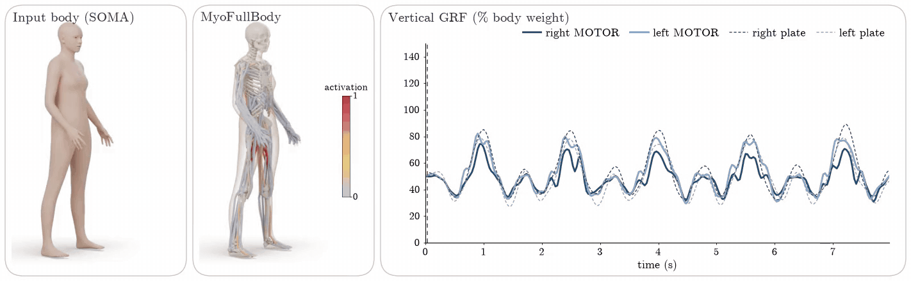
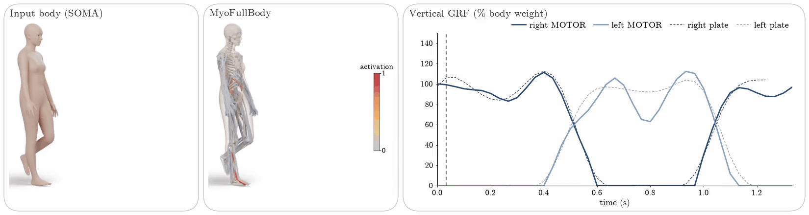
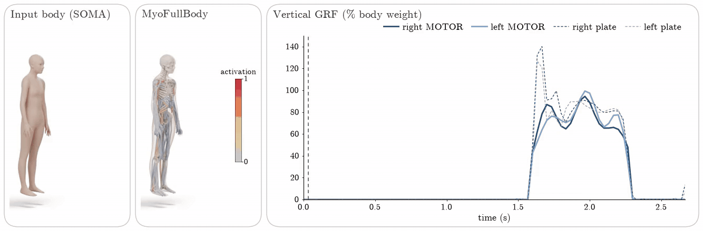

# MOTOR

*Squat, subject 2 of the public LabValidation dataset: the input body (SOMA), MyoFullBody with its muscle activations, and MOTOR's vertical ground reaction force per foot (solid) beside the trial's measured force plates (dashed).*



*Walking, subject 3 of the public LabValidation dataset.*



*Drop jump, subject 4 of the public LabValidation dataset (the force shown is the floor's; the box is not drawn).*



A GPU solver that puts the bodies estimated or generated by physical AI models onto the full musculoskeletal model
MyoFullBody, and returns joint angles, joint moments, ground reaction forces and the force in every muscle, using
Newton and MuJoCo Warp.

## What it does

MOTOR takes one physical-AI body, in SOMA's form (a skin mesh with its skin weights, the rig's segment frames every
frame, the person's mass and height, the ground it may touch), and:

1. **sizes** MyoFullBody (its bones, joints and 416 muscles) to the body: each bone group the length and mass of
   the SOMA segment it covers (`motor/sizing`, `motor/myo`);
2. **fits** it inside the skin: the segment rotations as the main target, about 100 anatomical landmarks defined from
   the ISB conventions placing the joint centres, the bones kept inside the skin; per-person constants solved once
   over all frames, then every frame's pose (`motor/fit`: mink per frame, SciPy's bounded least squares, a Warp
   Levenberg-Marquardt on the card);
3. **reduces the residuals** (OpenSim's RRA, in this stack: `motor/rra`), finds the **ground's contacts** on the
   skin (`motor/contact`, `motor/ground`) and the **inverse dynamics and static optimisation** of every frame at
   once on MuJoCo Warp (`motor/batched`, `motor/muscles`);
4. optionally runs the **whole-trial solve** (`motor/trial`): one solve over the whole recording that finds the
   movement, the ground reaction forces and the muscle forces together, warm started by steps 2 and 3.

Residual forces are measured and recorded, never applied. Nothing is stepped forward in time.

## Input

One `job.json` (its full shape is the docstring of `motor/run/__init__.py`):

- `rate` (frames a second), `gravity`, optional `model` (default: the vendored MyoFullBody in `vendor/myofullbody`);
- `people`: per person its `name`, `kg`, `height` (m), `rig` (`names`, `parents`, `bind`: SOMA's 27 joints),
  `segments` (the SOMA segment names, in the order of the targets) and `targets`, an `.npz` with `world`
  (frames x segments x 4 x 4, metres, Y up), `ground` (triangles, n x 3 x 3), `points`, `faces` and `weights` (the
  SOMA mesh at its bind, SOMA's LOD-low topology, and its skin weights);
- `residual` and `adjust`: the residual limits and RRA's caps; optional `motor`: `dynamics` or `muscles` for the
  whole-trial solve.

## Output

`out.json` and `out.npz` beside it, per person, every frame:

- **joint angles**: every MyoFullBody hinge's angle (`<name>/coordinates`, radians, with `<name>/coordinate names`),
  and each SOMA segment's rotation against its parent as its bone group turns (`angles`);
- **joint moments**: the generalised force each joint needs (`torques`, `own torques`, N m);
- **ground reaction forces**: the ground's push on every part it touches, with its centre of pressure (`ground`,
  `touches`, `feet`, N and m);
- **muscle forces**: every muscle's activation (0 to 1) and tension (`activations`, `forces`, N);
- the residual on the pelvis and the largest joint reserve (`residual`, `reserve`), the fit's and RRA's records
  and the wall seconds of every step (`seconds`).

## Run

Python 3.12 and a CUDA card (without one the run falls back to MuJoCo's CPU backend frame by frame; the card's
checks are skipped). The pins are in `pyproject.toml`: Newton 1.7.0, MuJoCo and MuJoCo Warp 3.15.0, Warp 1.18.0.

```bash
uv sync --frozen                                  # the Python, from uv.lock
.venv/bin/python -m motor.run job.json out.json   # one job
make tests                                        # the test rule's guard, then every test file
```

### Example on public data

```bash
.venv/bin/python -m examples.soma_template /tmp/motor-example --frames 30 --kg 70
```

It downloads SOMA-X's template body (NVlabs/SOMA-X assets v0.3.3, Apache-2.0, checked by sha256) into the output
folder, stands it still in its bind pose on a flat floor and runs MOTOR on it (`--motor muscles` adds the whole-trial
solve). The mass is an input: SOMA's template has none. It shows the solver running on a public body; it is not a
validation (a still pose has no movement to compare against).

## Validation

MOTOR is validated on OpenCap's public LabValidation dataset (single-camera video, against the lab's motion capture,
force plates and EMG). That pipeline still lives in [SCORE](https://github.com/Babon-Innovations-b-v/score)
(`tools/labval`), next to the video estimator and cloud runners it uses.

## Citation

The demo clips at the top (MP4 and GIF) are in [`paper/motor/demos`](paper/motor/demos).

The paper is a working draft, not yet published (its source is [`paper/motor`](paper/motor)):

> J.P. Kardolus. MOTOR: Musculoskeletal Optimisation Through Open Robotics Simulation. Working draft, 2026.

## Licence

The code is MIT ([LICENSE](LICENSE)). **The MIT licence covers this repository's code only.** The vendored
MyoFullBody model files in `vendor/myofullbody` keep their own licences, kept verbatim in
`vendor/myofullbody/licenses/`: MuscleMimic Models and MyoSuite/myo_sim under Apache-2.0, and the arm and hand,
derived from the MoBL-ARMS upper limb model, under a BSD 3-clause licence **for non-commercial use only** (commercial
use needs a licence from its copyright holders). See [NOTICE](NOTICE) for every third-party part and its licence.

**So MyoFullBody, and a MOTOR run with it, is for research and other non-commercial use.** A commercial user needs
the MoBL-ARMS holders' licence, or a body model without MoBL-ARMS's arm and hand.

MOTOR's code was written in SCORE (`score/stages/sim_body/inside`, commit `ae0f57ed6`) and moved here.
